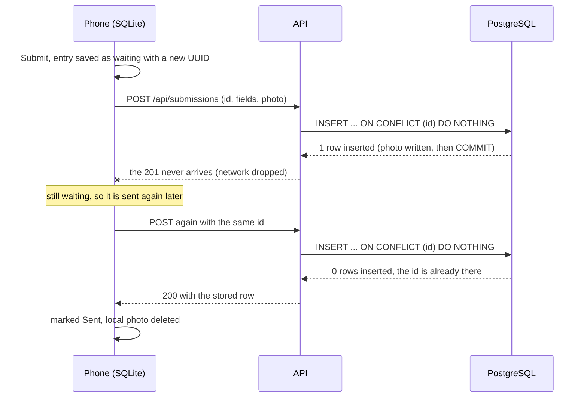

# Truck Entry: offline Android form app

**Download the APK:** [truck-entry-1.0.0.apk](https://github.com/Aniketk8104/offline-truck-entry/releases/download/v1.0.0/truck-entry-1.0.0.apk) (from the [v1.0.0 release](https://github.com/Aniketk8104/offline-truck-entry/releases/tag/v1.0.0))

**Demo video:** TODO add the link

**PINs to try:** Kolhapur `1234`, UP `4567`

Ground Up technical assignment (Full Stack Developer), Problem 2: Offline Android Form App. Built by Aniket ([@Aniketk8104](https://github.com/Aniketk8104)).

## What I built

- **An Android app** made with Expo SDK 58 (React Native, TypeScript). The user picks a plant, enters its PIN and fills in a form: name, truck number, a photo from the camera, and the location, which fills itself in. On Submit the app shows a 6-digit OTP. The entry is saved on the phone first, so all of this works in flight mode.
- **Automatic sync.** Saved entries are sent to the server as soon as the phone is online: when the network comes back, when the app is opened, every 30 seconds while it is open, and from an Android background task while it is closed.
- **A Node.js API** (Express 5, TypeScript) that stores each entry in **PostgreSQL 16** and its photo on disk. Sending the same entry twice never creates a second row.
- **Docker Compose files** that start the API and the database with one command, on a laptop or on a server behind HTTPS.

The APK talks to a hosted copy of the API over HTTPS, so it works on mobile data or any Wi-Fi.

## App flow

1. **Open the app.** It asks for camera and location permission. The camera is required, because the photo is mandatory. Location is optional: without it, entries are saved and marked "location not allowed".
2. **Choose a plant and enter its PIN.** The PIN is checked on the phone, so this works offline. After 5 wrong PINs, that plant is locked for 5 minutes.
3. **Fill in the form.** Name; truck number (typed as `mh 09 ab-1234`, saved as `MH09AB1234`); a photo from the camera (the gallery isn't offered). The location search starts as soon as the form opens. Latitude, longitude and accuracy appear by themselves, and when the phone is online, the place name too, from OpenStreetMap.
4. **Submit.** The app creates the OTP, saves the entry on the phone and shows the OTP screen at once, online or offline. If the phone is online, the entry is sent right away in the background.
5. **History** lists the entries on this phone with their OTP, time, place and status: *Waiting to send*, *Sent*, or *Refused by server* with the reason. *Send now* tries again at once. The header on every screen says "Offline · 2 waiting" or "All sent".

## Why Expo (React Native)

The brief asks for a mobile framework that fits a Next.js and Node.js team.

- **Same language, same UI model.** The app is TypeScript and React, like a Next.js front end, and the API is TypeScript on Node.js. A web developer already knows the components, hooks and state, and one team can work on all three parts.
- **A real native APK**, built in Expo's cloud service (EAS Build). Nobody needs Android Studio to build it.
- **Maintained Expo modules for everything this app needs:** SQLite, camera, location, secure random numbers and SHA-256, the file system, and background tasks (Android WorkManager underneath).

Other options I considered: native Kotlin has the best Android integration, but it is a second language and toolchain for a web team. Flutter uses Dart, also a separate stack. A web app (PWA) would reuse the most Next.js code, but the brief asks for an APK, and a browser can't promise to send data after the app is closed.

## Offline storage on the phone

Everything is kept in the app's private storage, so it survives closing the app and restarting the phone.

- **SQLite** (`expo-sqlite`): one database file with four tables.
  - `submissions`: one row per entry. All form fields, the OTP, the path of the photo file, and the sync state: `status` (`pending`, `synced` or `failed`), `attempts`, `next_attempt_at`, `last_error`.
  - `plants`: code, name, PIN salt and PIN hash. The app ships with the same values as the server and refreshes them from the API when online (at most every 10 minutes).
  - `pin_attempts`: wrong tries and lock time per plant.
  - `settings`: a random id for this install, sent with each entry.
- **Photos** are files in the app's documents folder, named after the entry: `photos/<entry id>.jpg`. The camera saves its photo in the cache folder, which Android may empty at any time, so the app copies it out at Submit.
- The SQLite schema has a version number (`PRAGMA user_version`), so an update can add a column without losing saved entries. Version 2 added the place name.

Why SQLite rather than AsyncStorage: the queue is simply rows in a table. The app can ask for "the oldest waiting entry whose retry time has come", update one row at a time, and use transactions. AsyncStorage is a key-value store, so the whole queue would be read and rewritten as one blob.

## Sync: how saved entries reach PostgreSQL

**When it runs**

| Trigger | Sends |
|---|---|
| The network comes back | every waiting entry, now |
| The app is opened, or comes back to the front | every waiting entry, now |
| *Send now* in History | every waiting entry, now |
| Right after Submit | entries that are due |
| Every 30 seconds while the app is open | entries whose retry time has come |
| Background task while the app is closed (Android WorkManager, at most about every 15 minutes, kept after a restart) | entries whose retry time has come |

**What one run does**

1. If the phone is offline, it stops at once, so time offline doesn't count as failed tries.
2. It takes the oldest waiting entry whose retry time has come and sends it in one multipart request: the fields plus the photo file. Entries go one at a time, oldest first, so they reach the server in the order they were made. An entry saved during a run is sent in that run.
3. It acts on the answer:
   - **201** (saved) or **200** (saved by an earlier try): marked *Sent*, and the photo is deleted from the phone.
   - **400** or **413** (the server says the data is wrong): marked *Refused by server*, with the reason. Sending it again can't help.
   - **No answer, a timeout (60 s), or any other error:** the entry keeps waiting and is tried again after 5 s, 10 s, 20 s and so on, up to 10 minutes. The run stops there, because the server can't be reached. The triggers marked "now" skip this wait.
4. Only one run happens at a time.

**Why an entry is never saved twice**

The entry's id is a UUID made on the phone at Submit and stored with it. Every retry sends the same id, and that id is the primary key in PostgreSQL. The API inserts with `INSERT ... ON CONFLICT (id) DO NOTHING`. If the id is already there, nothing is inserted and the API answers 200 with the stored row.



Two copies arriving at the same moment also give one row: PostgreSQL makes the second insert wait for the first one's transaction, then skips it. Both cases have tests.

## Database design (PostgreSQL 16)

The schema is in [`backend/migrations`](backend/migrations). Postgres runs these files once, when it starts with an empty data volume.

**`plants`**

| Column | Meaning |
|---|---|
| `code` | primary key, e.g. `KOLHAPUR`, `UP`. It is the same on the phone and the server, which an auto-numbered id wouldn't be. |
| `name` | shown in the dropdown |
| `pin_salt`, `pin_hash` | a random salt and `sha256(salt + PIN)` in hex. The PIN itself is never stored. |
| `is_active` | inactive plants are no longer sent to the app |
| `created_at` | when the plant was added |

**`submissions`**: one row per form

| Column | Meaning |
|---|---|
| `id` | UUID made on the phone; primary key, so a retry can't add a second row |
| `plant_code` | foreign key to `plants` |
| `person_name` | 2 to 100 characters |
| `truck_number` | capital letters and digits only, e.g. `MH09AB1234` |
| `photo_path`, `photo_mime`, `photo_bytes` | the photo's file name, type and size; the image itself is on disk |
| `latitude`, `longitude` | `NUMERIC(9,6)`, about 11 cm precision, range-checked; empty when there is no position |
| `location_accuracy_m` | accuracy reported by the phone, in metres |
| `location_status` | `ok` (fresh fix), `last_known` (a position up to 5 minutes old), `unavailable`, `denied` |
| `location_mocked` | true if Android reports that the position came from a mock-location app |
| `place_name` | e.g. "Shivaji Park, Kolhapur, Maharashtra", from OpenStreetMap; optional |
| `otp` | exactly 6 digits |
| `captured_at` | when Submit was pressed (phone clock) |
| `received_at` | when the server saved it (server clock); the gap shows how long the entry waited offline |
| `device_id`, `app_version` | which install and app version sent it |

Indexes: `(plant_code, captured_at DESC)` for a plant's newest entries, and `(truck_number)` to look up a truck.

Why this design:

- **One row per form, plain columns.** The form is fixed, so a generic key-value table would only make queries harder.
- **The database checks the rules too**, not only the API: name length, truck-number characters, a 6-digit OTP, coordinate ranges, and "a position is there exactly when the status says there is one". Bad data can't get in from any client, psql included.
- **Two clocks.** The phone's time records when the truck was at the gate. The server's time can be trusted and shows the offline delay.

### How the photo is stored

1. **On the phone,** the camera photo is resized to at most 1600 px on the longer side and saved as JPEG at 70% quality. In my tests that gave 55 to 170 KB, which uploads quickly on a weak network. It stays in the app's documents folder until the server has it, then it is deleted.
2. **Upload:** it is sent with the entry as a multipart file. The API keeps it in memory while it checks it: at most 8 MB (otherwise 413), and it must really be a JPEG or PNG, judged by its first bytes, not by its name or the type the phone claims.
3. **Saving:** in one database transaction the API inserts the row, writes the photo to the `uploads` volume as `<entry id>.jpg` (only if the row is new), then commits. If writing the file fails, the transaction is rolled back and the phone retries later, so a saved row always has its photo. A retry of an entry that is already saved writes nothing.
4. **Reading:** `GET /api/submissions/:id/photo`.

Why not in the database: images would make the database big and slow to back up, while files are cheap to store and serve. In production I would move them to object storage (S3 or MinIO) under the same `<entry id>.jpg` key; only the code that saves and reads them would change.

## PIN and OTP

**PIN**

- The server keeps only a random salt and `sha256(salt + PIN)` per plant. The app ships the same pair and refreshes it from the API when online.
- The app checks the PIN on the phone, `sha256(salt + typed PIN) == hash`, so the form opens without a network.
- A wrong PIN shows how many tries are left. After 5 wrong tries the plant is locked for 5 minutes, with a countdown. The lock is stored in SQLite, so closing the app or restarting the phone doesn't reset it. A double tap counts as one try.
- How to change a PIN is under [Assumptions and limits](#assumptions-and-limits).

**OTP**

- Made on the phone at Submit: 6 digits from the phone's secure random generator (`expo-crypto`). Every value from `000000` to `999999` is equally likely.
- Shown at once, online or offline, and stored with the entry on the phone and in PostgreSQL. It works as the entry's receipt code: the gate can find a truck's record by its OTP.
- It is made on the phone because, offline, there is no server to ask for one.

## Edge cases

| Edge case | What happens | Code |
|---|---|---|
| Camera or location permission denied | The permissions screen shows each permission as *Allowed* or *Not allowed* and why it is needed. Without the camera the form can't open; *Allow camera* asks again, and after Android's "don't ask again" it opens the app's settings. Without location the user can *Continue without location*, and entries are saved as `denied`. The screen checks again when the user comes back from settings. | [`PermissionsScreen.tsx`](app/src/screens/PermissionsScreen.tsx) |
| Wrong PIN | "Wrong PIN for Kolhapur. 3 tries left." After 5 wrong tries the plant is locked for 5 minutes, with a countdown. The lock is stored in SQLite, so restarting the app doesn't skip it. | [`pin.ts`](app/src/services/pin.ts), [`PlantPinScreen.tsx`](app/src/screens/PlantPinScreen.tsx) |
| GPS not available or slow | The search starts when the form opens and shows a seconds counter: GPS for up to 10 s, then Wi-Fi and mobile-network positioning, about 15 s in all. With no fix, the last known position is used if it is at most 5 minutes old, saved as `last_known` and shown as such. With nothing at all, the screen says so and offers *Try again*, and Submit still works (saved as `unavailable`), so a truck isn't held at the gate. If location is switched off on the phone, *Turn on location* opens Android's own dialog, and the search starts again by itself once it is on. Positions from mock-location apps are saved and flagged. | [`location.ts`](app/src/services/location.ts), [`FormScreen.tsx`](app/src/screens/FormScreen.tsx) |
| Several forms submitted offline | Each entry is its own row, with its own UUID and OTP. The header shows "Offline · 3 waiting". When the network is back they are sent one by one, oldest first. | [`submissions.ts`](app/src/db/submissions.ts), [`syncEngine.ts`](app/src/sync/syncEngine.ts) |
| App closed or phone restarted before sync | Entries are in SQLite and photos in the documents folder, and both are kept. They are sent on the next app start or network change, or by the background task without opening the app. | [`database.ts`](app/src/db/database.ts), [`backgroundTask.ts`](app/src/sync/backgroundTask.ts) |
| Network drops in the middle of sending | The entry stays waiting and is sent again with the same UUID. If the first try had reached the database, the API answers 200 with the stored row and nothing new is saved. Tested: the same entry twice, and two copies at the same moment. | [`api.ts`](app/src/sync/api.ts), [`submissionService.ts`](backend/src/services/submissionService.ts) |
| Server down or slow | Tries again after 5 s, 10 s, 20 s and so on, up to 10 minutes. Opening the app, the network coming back and *Send now* skip the wait. Uploads time out after 60 s. | [`syncEngine.ts`](app/src/sync/syncEngine.ts) |
| The server refuses an entry | 400 or 413: shown as *Refused by server* with the reason, and not sent again and again. A value that only the database refuses also gets 400, not 500, for the same reason. | [`errorHandler.ts`](backend/src/middleware/errorHandler.ts) |
| Double tap on Submit or Open form | One entry is saved, and one PIN try is counted. | [`FormScreen.tsx`](app/src/screens/FormScreen.tsx) |
| Back button on a half-filled form | The app asks before discarding the name, truck number and photo. | [`FormScreen.tsx`](app/src/screens/FormScreen.tsx) |
| Phone in dark mode | The app keeps its own light colours. Android's native dropdown turned white-on-white in dark mode, so the app draws its own. | [`ui.tsx`](app/src/ui.tsx) |

## Run the backend

Needs Docker with Compose v2 (Docker Desktop on Windows or macOS).

```bash
git clone https://github.com/Aniketk8104/offline-truck-entry.git
cd offline-truck-entry
cp .env.example .env            # Windows PowerShell: Copy-Item .env.example .env
docker compose up -d --build --wait
curl http://127.0.0.1:3000/health   # {"status":"ok"}   (Windows: curl.exe)
```

The first start creates the tables and the two plants. The API key is `API_KEY` in `.env` (`dev-api-key-change-me`), sent in the `x-api-key` header:

```bash
curl -H "x-api-key: dev-api-key-change-me" http://127.0.0.1:3000/api/plants
```

See the saved entries and photos:

```bash
docker compose exec db psql -U truck_api -d truck_entry -c "SELECT plant_code, truck_number, otp, location_status, place_name, captured_at, received_at FROM submissions ORDER BY captured_at DESC LIMIT 20"
docker compose exec api ls -l /app/uploads
```

`docker compose down` stops everything and keeps the data. `docker compose down -v` also deletes the data and the photos.

To reach this local API from a phone on the same Wi-Fi, set `API_BIND=0.0.0.0` in `.env`. On Windows the firewall may still block Docker's port; then run the API with Node instead: `docker compose stop api`, then `cd backend && npm ci && npm run dev`.

### Hosting with HTTPS

The demo API runs with [`docker-compose.server.yml`](docker-compose.server.yml) on a cloud VM behind an existing Traefik reverse proxy, which gets a Let's Encrypt certificate for the API's domain. It is its own Compose project: the database has no published port and sits on an internal network, each container is limited to 0.5 CPU and 256 MB, and logs are rotated. The server's `.env` sets the passwords, the API key and the domain (the comments at the top of the file list them). None of them are in this repo.

## Install the app

1. On the Android phone, open the [APK link](https://github.com/Aniketk8104/offline-truck-entry/releases/download/v1.0.0/truck-entry-1.0.0.apk) and download the file.
2. Open it. Android asks once to allow installs from your browser or file manager; allow it.
3. Open **Truck Entry**, allow camera and location, choose a plant and enter its PIN (Kolhapur `1234`, UP `4567`).

The APK uses the hosted API, so nothing else needs to run. On Xiaomi, Oppo, Vivo and similar phones, allow **Autostart** for Truck Entry, or the system may block the background sync. Sync while the app is open works either way.

### Run the app from source

```bash
cd app
npm ci
cp .env.example .env    # set EXPO_PUBLIC_API_URL to http://<your laptop's Wi-Fi IP>:3000
npx expo start
```

Scan the QR code with **Expo Go** (SDK 58) on a phone on the same Wi-Fi. Everything works in Expo Go except the background task.

### Build the APK

The APK is built by EAS Build with the `preview` profile in [`app/eas.json`](app/eas.json) (`"buildType": "apk"`). The API address and key are EAS environment variables of the `preview` environment, because `app/.env` is gitignored and is never uploaded. The address must use HTTPS: Android blocks plain HTTP in release builds.

```bash
cd app
npx eas-cli login
# To use your own Expo account, first remove "owner" and "extra.eas.projectId" from app.json.
npx eas-cli init
npx eas-cli env:create --environment preview --name EXPO_PUBLIC_API_URL --value https://your-api.example.com --type string --visibility plaintext
npx eas-cli env:create --environment preview --name EXPO_PUBLIC_API_KEY --value <your API_KEY> --type string --visibility sensitive
npx eas-cli build --platform android --profile preview
```

## API

| Method | Path | What it does |
|---|---|---|
| GET | `/health` | no key needed; 200 when the API and the database answer |
| GET | `/api/plants` | active plants: `code`, `name`, `pinSalt`, `pinHash` |
| POST | `/api/submissions` | multipart form: `id`, `plantCode`, `personName`, `truckNumber`, `latitude`, `longitude`, `accuracy`, `placeName`, `locationStatus`, `locationMocked`, `otp`, `capturedAt`, `deviceId`, `appVersion`, and the file `photo` |
| GET | `/api/submissions?plantCode=UP&limit=50` | newest first, each with a link to its photo |
| GET | `/api/submissions/:id/photo` | the stored photo |
| GET | `/api/place-name?lat=16.705&lon=74.243` | `{ "name": "Shivaji Park, Kolhapur, Maharashtra" }`, or `{ "name": null }` |

Everything under `/api` needs the `x-api-key` header. Answers to POST: `201` saved now, `200` already saved (a retry; returns the stored row), `400` a field is missing or wrong (each field is named), `401` wrong key, `413` photo over 8 MB, `500` a server problem (the app retries). Every error has the same shape: `{ "error": { "code", "message", "fields" } }`. Input is checked with zod at the API boundary, and SQL uses parameters only.

Place names come from OpenStreetMap's Nominatim service. The phone asks this API, and the API asks Nominatim, keeping to its usage policy: one request at a time and at most one per second, a User-Agent that names the app, a cache, and a setting (`GEOCODER_URL`) to switch to another service without a new APK. Only the coordinates are sent. Place names © OpenStreetMap contributors (ODbL).

## Tests

**Backend: 32 automated tests** (Jest and supertest), run against a separate test database that is built from the migration files:

```bash
docker compose up -d db
cd backend
npm ci
npm test
```

They cover a new entry (201) with its photo on disk; **the same entry sent twice: one row, 200 the second time**; **two copies at the same moment: one row**; truck-number clean-up; entries with `unavailable`, `denied` and `last_known` locations; every missing field named; a wrong OTP, name, truck number, coordinate, id or location combination (400); a value that only the database refuses (400, not 500); an unknown plant; a file that isn't an image; a photo over 8 MB (413); a wrong API key (401); the list and the photo download; the seeded PIN hashes matching only 1234 for Kolhapur and 4567 for UP; and place names, with OpenStreetMap replaced by a fixed answer.

**On a phone** (a Xiaomi Android phone, with the APK):

| # | Test | Expected | Result |
|---|---|---|---|
| 1 | Install, open, allow both permissions | The plant screen opens | ✓ |
| 2 | Submit an entry while online | OTP shown; the entry, photo, position and OTP reach PostgreSQL | ✓ |
| 3 | Fresh install, deny the camera | *Not allowed*, with *Allow camera* or *Open settings*; the form can't open | pending |
| 4 | Deny location, continue | Entry saved as "location not allowed" | pending |
| 5 | Wrong PIN 5 times, then close and reopen the app | Locked with a countdown, still locked after reopening | pending |
| 6 | Flight mode on, submit 3 entries | 3 OTPs; the header says "Offline · 3 waiting" | pending |
| 7 | Restart the phone, network on, open the app | All 3 marked *Sent*; 3 rows in PostgreSQL, with place names | pending |
| 8 | Stop the API, submit, start the API, *Send now* | Waiting with an error, then *Sent*; one row | pending |
| 9 | Location off, open the form, *Turn on location* | The position appears by itself | pending |
| 10 | Entries waiting, app swiped away, network on, wait 20 minutes | The background task sends them | pending |

## Problems found while testing on a phone

1. **Uploads failed although the network was fine.** In Expo SDK 58 the app's `fetch` is Expo's own, and its form-data code doesn't accept React Native's old `{ uri, name, type }` file object: it threw before sending anything. The photo is now attached as an `expo-file-system` `File`, and History shows the real error text.
2. **The first APK closed right after opening.** Release builds run R8, Android's code shrinker. R8 removed a constructor that WorkManager (used by the background task) creates by name at start-up ([expo/expo#52173](https://github.com/expo/expo/issues/52173)). Expo Go doesn't run R8, so this only showed up in the APK. R8 is turned off with `expo-build-properties`. With more time I would keep R8, add keep rules, and test the background task in a release build.
3. **The plant dropdown was unreadable** on a phone in dark mode: Android's native picker followed the dark theme and drew white text on a white box. `"userInterfaceStyle": "light"` does nothing on Android without `expo-system-ui`. I added that, and the dropdown is now drawn with plain views.
4. **The location search could hang** after turning location on from the form. While location is off, expo-location parks a request until Android's "turn on location" dialog is answered, and two of my steps had no time limit. Now no request waits for that dialog, every step has a time limit, only the newest search can update the screen, and the form searches again by itself once location is on.

## Assumptions and limits

- One APK serves all plants. Plants and PINs are seeded (Kolhapur 1234, UP 4567). To change a PIN, make a new salt and hash and update the row; phones pick it up at their next online refresh:
  ```bash
  node -e "const c=require('crypto'); const s=c.randomBytes(16).toString('hex'); console.log(s, c.createHash('sha256').update(s+'9876').digest('hex'))"
  docker compose exec db psql -U truck_api -d truck_entry -c "UPDATE plants SET pin_salt='<salt>', pin_hash='<hash>' WHERE code='KOLHAPUR'"
  ```
- The PIN is checked on the phone so the form opens offline. A 4-digit PIN has only 10,000 values, so someone who copies the hash off the phone can find the PIN. The hash only keeps PINs out of plain text, and the lockout limits guessing in the app. A real deployment would use per-user logins when online.
- The OTP is a receipt code made on the phone. It isn't sent by SMS or checked by the server; offline there is nothing to send it through.
- The API key is built into the APK. It keeps casual traffic and bots out, but anyone who unpacks the APK can read it. Production would register each device or log users in and give each one its own token.
- `captured_at` comes from the phone's clock and `received_at` from the server's. Changing the phone's clock could also shorten the PIN lockout.
- The truck-number check is loose (4 to 12 letters or digits after removing spaces, dots and dashes), so an unusual plate never blocks a truck at the gate. The photo shows the real plate.
- A plant marked inactive still accepts entries that were made offline before, so nothing recorded at the gate is lost.
- Android decides when the background task runs: at most about every 15 minutes, sometimes much later, and some phone brands block it unless Autostart is allowed. Sync while the app is open doesn't depend on it.
- With no fresh GPS fix, a position up to 5 minutes old is accepted and saved as `last_known`. Positions from mock-location apps are saved and flagged, not blocked.
- Sent entries stay in History on the phone; their photos are deleted. History shows the newest 200.
- Place names depend on OpenStreetMap's public service, which has little capacity. If it is slow or down, entries are saved without a name; the coordinates are the real record.
- Postgres runs the migration files only on an empty database. A file added later, like `003_add_place_name.sql`, has to be applied by hand to an existing one. A real project would use a migration tool.

## What I would add for production

- Device registration or user login instead of one shared API key.
- Photos in S3 or MinIO, served through short-lived signed links.
- A migration tool that records which files have run.
- R8 back on, with keep rules, and the background task tested in a release build.
- A small Next.js admin page to search entries by plant, truck number, OTP or date, with the photos.
- Monitoring and alerts (for example, entries waiting on a phone for more than an hour) and database backups.

## AI tools used

I used **Kiro**, the AI coding assistant in the Kiro IDE (running Anthropic's Claude), throughout the project: to turn the brief into a plan, to write most of the code and tests, to read library source code when something failed on the phone, and to draft this README. I worked in small commits. Each change was explained to me and checked (typecheck, automated tests, or my phone) before it went in, and I did the testing on my own Android phone. The app itself doesn't use any AI.

## Project structure

```
.
├── docker-compose.yml          API + PostgreSQL for local use
├── docker-compose.server.yml   the same behind a Traefik reverse proxy (HTTPS)
├── .env.example                settings; copy to .env
├── backend/                    Node.js API
│   ├── migrations/             001 tables, 002 the two plants, 003 place name
│   ├── src/
│   │   ├── app.ts, server.ts   Express app; start and clean shutdown
│   │   ├── config.ts           settings from environment variables, checked with zod
│   │   ├── routes/             plants, submissions, place-name
│   │   ├── services/           idempotent insert + photo, photo type, place names
│   │   ├── validation/         zod schema for a submission
│   │   └── middleware/         API key, upload limits, error format, request log
│   ├── tests/                  Jest + supertest
│   └── Dockerfile
└── app/                        Expo app
    ├── App.tsx                 screen switching, sync triggers, offline banner
    ├── index.ts                defines the background task at start-up
    ├── app.json, eas.json      app settings, APK build profile
    └── src/
        ├── screens/            Permissions, PlantPin, Form, Otp, History
        ├── db/                 SQLite schema, plants, submissions
        ├── services/           pin, otp, location, photo, validation
        ├── sync/               syncEngine, api, backgroundTask
        └── ui.tsx              shared components and colours
```
