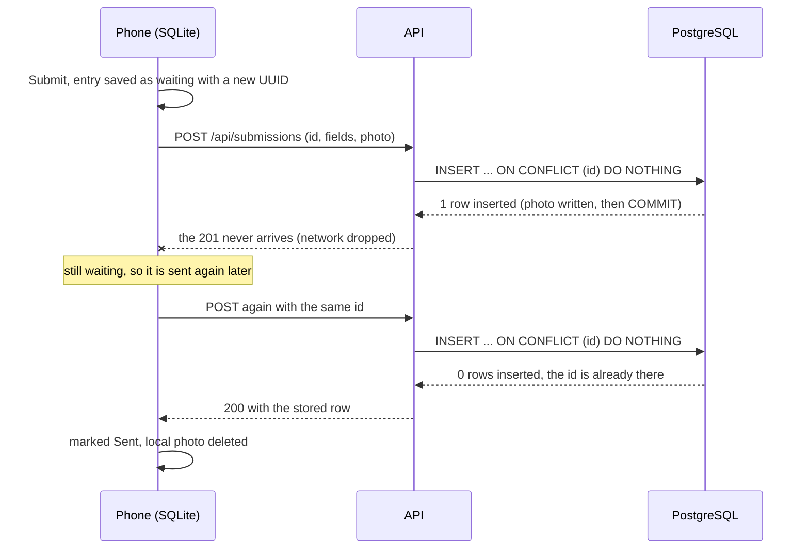
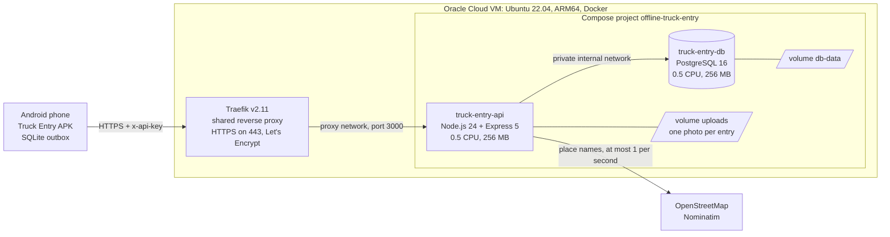
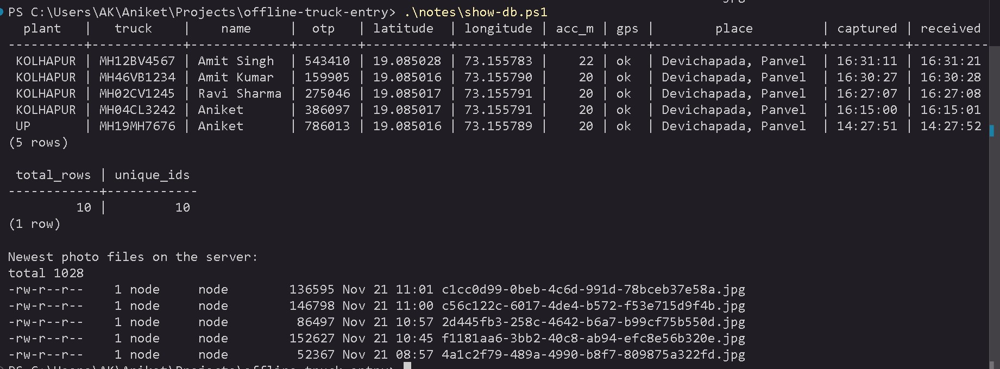

# Truck Entry: offline Android form app

**Download the APK:** [truck-entry-1.0.0.apk](https://github.com/Aniketk8104/offline-truck-entry/releases/download/v1.0.0/truck-entry-1.0.0.apk) (from the [v1.0.0 release](https://github.com/Aniketk8104/offline-truck-entry/releases/tag/v1.0.0))

**Demo video:** [watch on Google Drive](https://drive.google.com/file/d/1Sm-V76gItZIU5qzCWKfgrFH135AEGioW/view?usp=sharing)

**PINs to try:** Kolhapur `1234`, UP `4567`

Ground Up technical assignment (Full Stack Developer), Problem 2: Offline Android Form App. Built by Aniket ([@Aniketk8104](https://github.com/Aniketk8104)).

## Contents

1. [What I built](#what-i-built)
2. [Why Expo (React Native)](#why-expo-react-native)
3. [Tech stack](#tech-stack)
4. [App flow](#app-flow)
5. [Offline storage and sync](#offline-storage-and-sync)
6. [Database design](#database-design)
7. [PIN and OTP](#pin-and-otp)
8. [Edge cases](#edge-cases)
9. [Run the backend](#run-the-backend)
10. [Install the app](#install-the-app)
11. [Deployment](#deployment)
12. [API](#api)
13. [Tests](#tests)
14. [Assumptions](#assumptions)
15. [What I would add for production](#what-i-would-add-for-production)
16. [AI tools used](#ai-tools-used)
17. [Project structure](#project-structure)

## What I built

- **An Android app** (Expo, React Native, TypeScript). The user picks a plant, enters its PIN and fills in a form: name, truck number, a photo from the camera, and the latitude and longitude, which fill themselves in. On Submit the app shows a 6-digit OTP. Everything works in flight mode.
- **Automatic sync.** Each entry is saved on the phone first. It is sent to the server by itself as soon as the phone is online.
- **A Node.js API** (Express, TypeScript) that stores each entry in **PostgreSQL** and its photo on disk. Sending the same entry twice never creates a second row.
- **Docker Compose** files that start the API and the database with one command. The APK uses a hosted copy over HTTPS, so it works on mobile data or any Wi-Fi.

**Where the data lives:** PostgreSQL is the database, and every entry ends up there. The phone only keeps an entry until the server has confirmed it, in a small SQLite outbox, because PostgreSQL can't run on a phone.

## Why Expo (React Native)

- **Same language and UI model as a Next.js / Node.js team.** The app is TypeScript and React, and the API is TypeScript on Node.js. A web developer already knows the components, hooks and state, and one team can work on all three parts.
- **A real native APK**, built in Expo's cloud service (EAS Build), without Android Studio.
- **Maintained modules for everything the app needs:** SQLite, camera, location, secure random numbers and SHA-256, files, and background tasks (Android WorkManager underneath).

I also considered native Kotlin and Flutter (each a second language and toolchain for a web team) and a web app (a browser can't promise to send data after the app is closed, and the brief asks for an APK).

## Tech stack

| Part | Used |
|---|---|
| Mobile app | Expo SDK 58, React Native 0.88, React 19, TypeScript |
| Phone storage | `expo-sqlite` (outbox, plants, PIN lock), `expo-file-system` (photos) |
| Phone features | `expo-image-picker` (camera), `expo-image-manipulator` (resize), `expo-location` (GPS), `expo-crypto` (UUID, OTP, SHA-256), `@react-native-community/netinfo` (online or offline), `expo-background-task` and `expo-task-manager` (sync while closed) |
| APK build | EAS Build, `expo-build-properties`, `expo-splash-screen`, `expo-system-ui` |
| API | Node.js 24, Express 5, TypeScript, `pg` (PostgreSQL driver), `zod` (input checks), `multer` (photo upload), `pino` (logs) |
| Database | PostgreSQL 16 |
| Tests | Jest and supertest, against a real test database |
| Hosting | Docker, Docker Compose v2, Traefik v2.11 with Let's Encrypt HTTPS, an Oracle Cloud VM (Ubuntu 22.04, ARM64) |
| Place names | OpenStreetMap Nominatim, through the API |

## App flow

1. **Open the app.** It asks for camera and location permission. The camera is required, because the photo is mandatory. Location is optional: without it, entries are saved and marked "location not allowed".
2. **Choose a plant from the dropdown and enter its PIN.** The PIN is checked on the phone, so this works offline. The form opens only for the right PIN. After 5 wrong PINs, that plant is locked for 5 minutes.
3. **Fill in the form.** Name, truck number (typed `mh 09 ab-1234`, saved `MH09AB1234`), a photo from the camera (no gallery). Latitude, longitude and accuracy appear by themselves; when online, the place name too.
4. **Submit.** The app makes the OTP, saves the entry on the phone and shows the OTP at once, online or offline. If the phone is online, the entry is sent right away.
5. **History** lists the entries with their OTP, time, place and status: *Waiting to send*, *Sent*, or *Refused by server* with the reason. *Send now* tries again at once. The header on every screen says "Offline · 2 waiting" or "All sent".

## Offline storage and sync

### On the phone

One SQLite database in the app's private storage, so it survives closing the app and restarting the phone:

- `submissions`: every entry with all its fields, the OTP, the photo's file path, and its sync state: `status` (`pending`, `synced` or `failed`), `attempts`, `next_attempt_at`, `last_error`.
- `plants`: code, name, PIN salt and PIN hash. Shipped with the app (the same values as the server) and refreshed from the API when online, at most every 10 minutes.
- `pin_attempts`: wrong tries and lock time per plant.
- `settings`: a random id for this install, sent with each entry.

Photos are files in the app's documents folder, named `photos/<entry id>.jpg`. The camera saves its photo in the cache folder, which Android may empty at any time, so the app copies it out at Submit. The schema has a version number (`PRAGMA user_version`), so an app update can add a column without losing saved entries; version 2 added the place name.

I chose SQLite over AsyncStorage because the queue is rows in a table: the app can ask for "the oldest waiting entry whose retry time has come", update one row at a time, and use transactions. AsyncStorage would read and rewrite the whole queue as one blob.

### When sync runs

| Trigger | Sends |
|---|---|
| The network comes back | every waiting entry, now |
| The app is opened, or comes back to the front | every waiting entry, now |
| *Send now* in History | every waiting entry, now |
| Right after Submit | entries that are due |
| Every 30 seconds while the app is open | entries whose retry time has come |
| Background task while the app is closed (Android WorkManager; minimum interval 15 minutes, schedule kept after a restart; Android chooses the actual time and may delay it) | entries whose retry time has come |

### What one sync run does

1. If the phone is offline, it stops at once, so time offline doesn't count as failed tries.
2. It takes the oldest waiting entry whose retry time has come and sends it in one multipart request: the fields plus the photo file. Entries go one at a time, oldest first, so they reach the server in the order they were made. An entry saved during a run is sent in that run.
3. An entry made offline has no place name yet; it is looked up just before sending (best effort).
4. It acts on the answer:
   - **201** (saved) or **200** (saved by an earlier try): marked *Sent*, and the phone deletes its copy of the photo.
   - **400** or **413** (the data is wrong): marked *Refused by server* with the reason. Sending it again can't help.
   - **No answer, a timeout (60 s), 401 or 5xx:** stays waiting and is tried again after 5 s, 10 s, 20 s and so on, up to 10 minutes, so a struggling server isn't flooded. The run stops there. The triggers marked "now" skip this wait.
5. Only one run happens at a time: a second call gets the run already going.

There is no `syncing` status on purpose. If the app is killed in the middle of a send, the entry is still `pending`, so it is simply sent again.

### Why an entry is never saved twice

At Submit the phone makes a UUID for the entry. Every retry sends the same UUID, and it is the primary key in PostgreSQL. The API inserts with `INSERT ... ON CONFLICT (id) DO NOTHING`: if the id is already there, nothing is inserted and the API answers 200 with the stored row.



Two copies arriving at the same moment also give one row: PostgreSQL makes the second insert wait for the first one's transaction, then skips it. Both cases have automated tests.

## Database design

PostgreSQL 16. The schema is in [`backend/migrations`](backend/migrations): `001_init.sql` (tables), `002_seed_plants.sql` (the two plants), `003_add_place_name.sql`. Postgres runs these files once, when it starts with an empty data volume.

**`plants`**

| Column | Meaning |
|---|---|
| `code` | primary key, e.g. `KOLHAPUR`, `UP`. The same on the phone and the server, which an auto-numbered id wouldn't be. |
| `name` | shown in the dropdown |
| `pin_salt`, `pin_hash` | a random salt and `sha256(salt + PIN)` in hex. The PIN itself is never stored. |
| `is_active` | inactive plants are no longer sent to the app |
| `created_at` | when the plant was added |

**`submissions`**: one row per form

| Column | Meaning |
|---|---|
| `id` | UUID made on the phone; primary key, so a retry can't add a second row |
| `plant_code` | foreign key to `plants` |
| `person_name` | 2 to 100 characters |
| `truck_number` | capital letters and digits only, e.g. `MH09AB1234` |
| `photo_path`, `photo_mime`, `photo_bytes` | the photo's file name, type and size; the image itself is on disk |
| `latitude`, `longitude` | `NUMERIC(9,6)`, about 11 cm precision, range-checked; empty when there is no position |
| `location_accuracy_m` | accuracy reported by the phone, in metres |
| `location_status` | `ok` (fresh fix), `last_known` (a position up to 5 minutes old), `unavailable`, `denied` |
| `location_mocked` | true if Android reports the position came from a mock-location app |
| `place_name` | e.g. "Shivaji Park, Kolhapur, Maharashtra", from OpenStreetMap; optional |
| `otp` | exactly 6 digits |
| `captured_at` | when Submit was pressed (phone clock) |
| `received_at` | when the server saved it (server clock); the gap shows how long the entry waited offline |
| `device_id`, `app_version` | which install and app version sent it |

Indexes: `(plant_code, captured_at DESC)` for a plant's newest entries, and `(truck_number)` to look up a truck.

Why this design:

- **Plain columns, one row per form.** The form is fixed, so a generic key-value table would only make queries harder.
- **The database checks the rules too**, not only the API: name length, truck-number characters, a 6-digit OTP, coordinate ranges, and "a position exactly when the status says there is one". Bad data can't get in from any client, psql included.
- **Two clocks.** The phone's time records when the truck was at the gate. The server's time can be trusted and shows the offline delay.

### How the photo is stored

1. **On the phone,** the camera photo is resized to at most 1600 px on the longer side and saved as JPEG at 70% quality (55 to 170 KB in my tests), so it uploads quickly on a weak network. It stays in the documents folder until the server has it, then it is deleted.
2. **Upload:** sent with the entry as a multipart file. The API keeps it in memory while it checks it: at most 8 MB (otherwise 413), and it must really be a JPEG or PNG, judged by its first bytes, not by its name or the type the phone claims.
3. **Saving:** the API opens a database transaction, inserts the row, writes the photo to the `uploads` volume as `<entry id>.jpg` (only if the row is new), and only then commits. If the file can't be written, the row is rolled back and the phone retries, so a saved row always has its photo. A retry of an entry that is already saved writes nothing. The file itself isn't part of the transaction: if the commit failed after the file was written, the file would stay without a row. The phone's retry then saves the row and writes the same file name again, so nothing is lost or duplicated. The app has no cleanup job for a file whose entry is never resent; production would add a periodic one.
4. **Reading:** `GET /api/submissions/:id/photo`.

Why not in the database: images would make it big and slow to back up, while files are cheap to store and serve. In production they would move to S3 or MinIO under the same `<entry id>.jpg` key; only the code that saves and reads them would change.

## PIN and OTP

**PIN**

- Each plant has a random salt and `sha256(salt + PIN)`. The app ships the same pair and refreshes it from the API when online.
- The app checks `sha256(salt + typed PIN) == hash` on the phone, so the form opens without a network.
- A wrong PIN shows how many tries are left. After 5 wrong tries the plant is locked for 5 minutes, with a countdown. The lock is stored in SQLite, so closing the app or restarting the phone doesn't reset it. A double tap counts as one try.

**OTP**

- Made on the phone at Submit: 6 digits from the phone's secure random generator (`expo-crypto`). Every value from `000000` to `999999` is equally likely.
- Shown at once, online or offline, and stored with the entry on the phone and in PostgreSQL. It is a receipt code for the entry: not an SMS code, and it doesn't log anyone in.
- It isn't guaranteed to be unique (two entries can get the same 6 digits). The entry's UUID is its unique id.
- It is made on the phone because, offline, there is no server to ask for one.

## Edge cases

| Edge case | What happens | Code |
|---|---|---|
| Camera or location permission denied | The screen shows each permission as *Allowed* or *Not allowed* and why it is needed. Without the camera the form can't open; *Allow camera* asks again, and after Android's "don't ask again" it opens the app's settings. Without location, *Continue without location* works and entries are saved as `denied`. The screen checks again when the user comes back from settings. | [`PermissionsScreen.tsx`](app/src/screens/PermissionsScreen.tsx) |
| Wrong PIN | "Wrong PIN for Kolhapur. 3 tries left." After 5 wrong tries the plant is locked for 5 minutes, with a countdown that survives closing the app. | [`pin.ts`](app/src/services/pin.ts), [`PlantPinScreen.tsx`](app/src/screens/PlantPinScreen.tsx) |
| GPS not available or slow | The search starts when the form opens and shows a seconds counter: GPS for up to 10 s, then Wi-Fi and mobile-network positioning, about 15 s in all. With no fix, a position up to 5 minutes old is used (`last_known`). With nothing at all, *Try again* is offered and Submit still works (`unavailable`), so a truck isn't held at the gate. If location is switched off, *Turn on location* opens Android's dialog and the search restarts by itself. | [`location.ts`](app/src/services/location.ts), [`FormScreen.tsx`](app/src/screens/FormScreen.tsx) |
| Several forms submitted offline | Each is its own row with its own UUID and OTP. The header shows "Offline · 3 waiting". They are sent one by one, oldest first. | [`submissions.ts`](app/src/db/submissions.ts), [`syncEngine.ts`](app/src/sync/syncEngine.ts) |
| App closed or phone restarted before sync | Entries are in SQLite and photos in the documents folder, and both are kept. They are sent on the next app start or network change, or by the background task without opening the app. | [`database.ts`](app/src/db/database.ts), [`backgroundTask.ts`](app/src/sync/backgroundTask.ts) |
| Network drops in the middle of sending | The entry stays waiting and is sent again with the same UUID. If the server already saved it, it answers 200 with the stored row and nothing new is saved. Tested, including two copies at the same moment. | [`api.ts`](app/src/sync/api.ts), [`submissionService.ts`](backend/src/services/submissionService.ts) |
| Server down or slow | Tries again after 5 s, 10 s, 20 s and so on, up to 10 minutes. Opening the app, the network coming back and *Send now* skip the wait. Uploads time out after 60 s. | [`syncEngine.ts`](app/src/sync/syncEngine.ts) |
| The server refuses an entry | 400 or 413: shown as *Refused by server* with the reason, not resent forever. A value only the database refuses also gets 400, not 500, for the same reason. | [`errorHandler.ts`](backend/src/middleware/errorHandler.ts) |
| Double tap on Submit or Open form | One entry is saved, and one PIN try is counted. | [`FormScreen.tsx`](app/src/screens/FormScreen.tsx) |
| Back on a half-filled form | The app asks before discarding the name, truck number and photo. | [`FormScreen.tsx`](app/src/screens/FormScreen.tsx) |
| Phone in dark mode | The app keeps its own light colours and draws its own dropdown, because Android's native one turned white-on-white. | [`ui.tsx`](app/src/ui.tsx) |
| Mock-location app | The position is saved and flagged, not blocked. | [`location.ts`](app/src/services/location.ts) |

## Run the backend

Needs Docker with Compose v2 (Docker Desktop on Windows or macOS).

```bash
git clone https://github.com/Aniketk8104/offline-truck-entry.git
cd offline-truck-entry
cp .env.example .env            # Windows PowerShell: Copy-Item .env.example .env
docker compose up -d --build --wait
curl http://127.0.0.1:3000/health   # {"status":"ok"}   (Windows: curl.exe)
```

The first start creates the tables and the two plants. The API key is `API_KEY` in `.env` (`dev-api-key-change-me`), sent in the `x-api-key` header:

```bash
curl -H "x-api-key: dev-api-key-change-me" http://127.0.0.1:3000/api/plants
```

See the saved entries and photos:

```bash
docker compose exec db psql -U truck_api -d truck_entry -c "SELECT plant_code, truck_number, otp, latitude, longitude, location_status, place_name, captured_at, received_at FROM submissions ORDER BY captured_at DESC LIMIT 20"
docker compose exec api ls -l /app/uploads
```

`docker compose down` stops everything and keeps the data. `docker compose down -v` also deletes the data and the photos.

Run the tests (they use their own database, built from the migration files):

```bash
docker compose up -d db
cd backend
npm ci
npm test
```

## Install the app

1. On an Android phone, open the [APK link](https://github.com/Aniketk8104/offline-truck-entry/releases/download/v1.0.0/truck-entry-1.0.0.apk) and download the file.
2. Open it. Android asks once to allow installs from your browser or file manager; allow it.
3. Open **Truck Entry**, allow camera and location, choose a plant and enter its PIN (Kolhapur `1234`, UP `4567`).

The APK uses the hosted API, so nothing else needs to run. On Xiaomi, Oppo, Vivo and similar phones, allow **Autostart** for Truck Entry, or the system may block the background sync. Sync while the app is open works either way.

### Run the app from source

```bash
cd app
npm ci
cp .env.example .env    # set EXPO_PUBLIC_API_URL to http://<your laptop's Wi-Fi IP>:3000
npx expo start
```

Scan the QR code with **Expo Go** (SDK 58) on a phone on the same Wi-Fi. Everything works in Expo Go except the background task. To reach the local API from the phone, set `API_BIND=0.0.0.0` in the root `.env`. On Windows the firewall may still block Docker's port; then run the API with Node instead: `docker compose stop api`, then `cd backend && npm ci && npm run dev`.

### Build the APK

The APK is built by EAS Build with the `preview` profile in [`app/eas.json`](app/eas.json) (`"buildType": "apk"`). The API address and key are EAS environment variables of the `preview` environment, because `app/.env` is gitignored and never uploaded. The address must use HTTPS: Android blocks plain HTTP in release builds.

```bash
cd app
npx eas-cli login
# To use your own Expo account, first remove "owner" and "extra.eas.projectId" from app.json.
npx eas-cli init
npx eas-cli env:create --environment preview --name EXPO_PUBLIC_API_URL --value https://your-api.example.com --type string --visibility plaintext
npx eas-cli env:create --environment preview --name EXPO_PUBLIC_API_KEY --value <your API_KEY> --type string --visibility sensitive
npx eas-cli build --platform android --profile preview
```

EAS uploads `app/` (without gitignored files), generates the native Android project, compiles it, signs it with a keystore it keeps for the project, and returns a download link. That file is the APK on the release page. The API address and key are written into the app at build time, so a new server address needs a new build.

## Deployment

### How it works right now

The APK on the release page is a finished, standalone app with the API address and key built in:

1. The phone saves each entry in SQLite and shows the OTP, online or offline.
2. When the phone is online, the sync sends the entry over HTTPS to the hosted API.
3. Traefik on the server receives the request, handles HTTPS, and passes it to the API container.
4. The API checks the entry, saves the row in PostgreSQL and the photo in the `uploads` volume, and answers 201 (or 200 for a retry).
5. The phone marks the entry *Sent* and deletes its copy of the photo.

### Where

| | |
|---|---|
| Machine | An Oracle Cloud (OCI) virtual machine: Ubuntu 22.04 LTS, ARM64 (aarch64), 2 CPUs. Other apps run on the same VM, so this project is kept fully separate from them. |
| Reverse proxy | Traefik v2.11, already running on the VM. It owns ports 80 and 443 and gets Let's Encrypt certificates. |
| Address | A subdomain of my own domain, with a DNS A record pointing to the VM. HTTPS only, because Android release builds block plain HTTP. |
| Software | Docker Engine 29 with Compose v2 |
| Folder | `/opt/offline-truck-entry`, holding `.env` (passwords, API key, domain; `chmod 600`, only on the server), `docker-compose.server.yml` and `backend/` from this repo |

### Server structure



### How Docker is used

| Container | Built from | Job | Networks | Data |
|---|---|---|---|---|
| `truck-entry-api` | [`backend/Dockerfile`](backend/Dockerfile), built on the server | the Express API on port 3000; the port isn't published, only Traefik reaches it | `proxy` (Traefik's) and `private` | volume `uploads` |
| `truck-entry-db` | `postgres:16-alpine` | PostgreSQL 16 | `private` only | volume `db-data` |

- **The image** is built in two stages: the first installs every package and compiles the TypeScript, the second holds only the production packages and the compiled JavaScript and runs as the unprivileged `node` user. The base images are multi-architecture, so the same files build on the ARM server and an x86 laptop.
- **Networks.** `private` is an `internal` Docker network with no published port and no internet, so only the API can reach the database. The API also joins Traefik's network, the only thing shared with the rest of the VM.
- **HTTPS and routing** come from labels on the API container. Traefik reads them from Docker, sends requests for the domain to port 3000 and gets the certificate. No Traefik configuration file was edited, and the route disappears when the container is removed.
- **Health checks.** Postgres is checked with `pg_isready`, the API with `GET /health`, which also queries the database. The API starts only once the database is healthy.
- **Sharing the VM safely.** Each container is limited to 0.5 CPU and 256 MB (each uses about 40 MB). Logs rotate at 3 × 10 MB. `restart: unless-stopped` brings both back after a reboot. Service names are unique, so they can't clash with other containers on the proxy network.
- **Data** is in named volumes, so rebuilding the containers keeps the entries and photos.

The local [`docker-compose.yml`](docker-compose.yml) is the same API and database without Traefik: ports are published on `127.0.0.1` only.

### How it was deployed

1. Added a DNS A record for the subdomain, pointing to the VM.
2. Copied `backend/` and `docker-compose.server.yml` into `/opt/offline-truck-entry` with `git archive` and `scp`, so only committed files reach the server.
3. Wrote the server's `.env` with long random values made on my laptop (`POSTGRES_USER`, `POSTGRES_PASSWORD`, `POSTGRES_DB`, `API_KEY`), plus `PUBLIC_HOST`, `PROXY_NETWORK` and `COMPOSE_FILE=docker-compose.server.yml`. Then `chmod 600 .env`.
4. Started it with `docker compose up -d --build --wait`, which waits until both containers are healthy.
5. Checked it: `GET /health` answers over HTTPS, `/api/plants` with the key returns the two plants, a wrong key gets 401, the certificate is from Let's Encrypt, and the VM's other containers kept running untouched.

**Updating:** copy the new `backend/`, apply any new migration file with `psql`, then run `docker compose up -d --build --wait` again; the data stays. **Removing:** `docker compose down -v`.

## API

| Method | Path | What it does |
|---|---|---|
| GET | `/health` | no key needed; 200 when the API and the database answer |
| GET | `/api/plants` | active plants: `code`, `name`, `pinSalt`, `pinHash` |
| POST | `/api/submissions` | multipart form: `id`, `plantCode`, `personName`, `truckNumber`, `latitude`, `longitude`, `accuracy`, `placeName`, `locationStatus`, `locationMocked`, `otp`, `capturedAt`, `deviceId`, `appVersion`, and the file `photo` |
| GET | `/api/submissions?plantCode=UP&limit=50` | newest first, each with a link to its photo |
| GET | `/api/submissions/:id/photo` | the stored photo |
| GET | `/api/place-name?lat=16.705&lon=74.243` | `{ "name": "Shivaji Park, Kolhapur, Maharashtra" }`, or `{ "name": null }` |

Everything under `/api` needs the `x-api-key` header. Answers to POST: `201` saved now, `200` already saved (a retry; returns the stored row), `400` a field is missing or wrong (each field is named), `401` wrong key, `413` photo over 8 MB, `500` a server problem (the app retries). Every error has the same shape: `{ "error": { "code", "message", "fields" } }`. Input is checked with zod at the API boundary, SQL uses parameters only, and the API key is compared in constant time.

Place names come from OpenStreetMap's Nominatim service. The phone asks this API, and the API asks Nominatim, keeping to its usage policy: one request at a time and at most one per second, a User-Agent that names the app, a cache, and a setting (`GEOCODER_URL`) to switch services without a new APK. Only the coordinates are sent. Place names © OpenStreetMap contributors (ODbL).

## Tests

**Backend: 32 automated tests** (Jest and supertest), run against a separate test database built from the migration files. They cover:

- a new entry (201) with its photo on disk;
- **the same entry sent twice: one row, 200 the second time**;
- **two copies at the same moment: one row**;
- truck-number clean-up; entries with `unavailable`, `denied` and `last_known` locations;
- every missing field named; a wrong OTP, name, truck number, coordinate, id or location combination (400);
- a value only the database refuses (400, not 500); an unknown plant; a file that isn't an image; a photo over 8 MB (413); a wrong API key (401);
- the list and the photo download; the seeded PIN hashes matching only 1234 for Kolhapur and 4567 for UP;
- place names, with OpenStreetMap replaced by a fixed answer.

**On a phone** (Xiaomi, with the APK):

| Test | Result |
|---|---|
| Fresh install, deny the camera | *Not allowed*, the form can't open; *Allow camera* / *Open settings* |
| Deny location, continue | The app works; the form says the location permission is off |
| Wrong PIN 5 times, close and reopen the app | "2 tries left", then "Try again in 4:50"; still locked after reopening |
| Location off, *Turn on location* | Android's dialog; the position appears by itself |
| Submit online | OTP shown; the entry, photo and position reach PostgreSQL |
| Flight mode on, submit entries | Each gets its OTP; the header says "Offline" and the number waiting |
| Flight mode off | "All sent"; the entry reached PostgreSQL 10 s later (16:31:11 → 16:31:21) with its place name |
| Rows against unique ids on the server | 10 rows, 10 unique ids: nothing saved twice |

The demo's rows in PostgreSQL on the hosted server, after the network came back:



### Problems found while testing on a phone

1. **Uploads failed although the network was fine.** In Expo SDK 58 the app's `fetch` is Expo's own, and its form-data code doesn't accept React Native's old `{ uri, name, type }` file object: it threw before sending anything. The photo is now attached as an `expo-file-system` `File`, and History shows the real error text.
2. **The first APK closed right after opening.** Release builds run R8, Android's code shrinker. R8 removed a constructor that WorkManager (used by the background task) creates by name at start-up ([expo/expo#52173](https://github.com/expo/expo/issues/52173)). Expo Go doesn't run R8, so this only showed up in the APK. R8 is turned off with `expo-build-properties`.
3. **The plant dropdown was unreadable** in dark mode: Android's native picker followed the dark theme and drew white text on a white box. `"userInterfaceStyle": "light"` does nothing on Android without `expo-system-ui`. I added that, and the dropdown is now drawn with plain views.
4. **The location search could hang** after turning location on from the form. While location is off, expo-location parks a request until Android's "turn on location" dialog is answered, and two steps had no time limit. Now no request waits for that dialog, every step has a time limit, only the newest search can update the screen, and the form searches again by itself once location is on.

## Assumptions

- One APK serves all plants. Plants and PINs are seeded (Kolhapur 1234, UP 4567). To change a PIN, make a new salt and hash and update the row; phones pick it up at their next online refresh:
  ```bash
  node -e "const c=require('crypto'); const s=c.randomBytes(16).toString('hex'); console.log(s, c.createHash('sha256').update(s+'9876').digest('hex'))"
  docker compose exec db psql -U truck_api -d truck_entry -c "UPDATE plants SET pin_salt='<salt>', pin_hash='<hash>' WHERE code='KOLHAPUR'"
  ```
- The PIN is a simple gate for choosing a plant, not strong authentication. It has to be checked on the phone so the form opens offline, so the salt and hash are on the phone too. A 4-digit PIN has only 10,000 values: someone who extracts the hash can try them all, and the 5-try lockout only works inside the unmodified app. The hash just keeps the PIN out of plain text. A real deployment would use per-user logins when online and device-level protection.
- The OTP is a receipt code made on the phone. It isn't sent by SMS or checked by the server, because offline there is nothing to send it through.
- The API key is built into the APK. It keeps casual traffic out, but anyone who unpacks the APK can read it and use the API, including the read endpoints. Production would give each device or user its own token.
- `captured_at` comes from the phone's clock and `received_at` from the server's. Changing the phone's clock could also shorten the PIN lockout.
- The truck-number check is loose (4 to 12 letters or digits after removing spaces, dots and dashes), so an unusual plate never blocks a truck at the gate; the photo shows the real plate.
- With no fresh GPS fix, a position up to 5 minutes old is accepted and saved as `last_known`.
- Android decides when the background task runs. It is scheduled with a minimum interval of 15 minutes, but battery saving and phone-brand rules can delay it, and some brands block it unless Autostart is on. The main path is the immediate sync when the app is open and the network returns, which doesn't depend on it.
- A plant marked inactive still accepts entries made offline before, so nothing recorded at the gate is lost.
- Sent entries stay in History as receipts (the newest 200 are shown); their photos are deleted from the phone.
- Place names come from OpenStreetMap's public service. If it is slow or down, the entry is saved without a name; the coordinates are the real record.
- Postgres runs the migration files only on an empty database; a file added later, like `003_add_place_name.sql`, is applied by hand to an existing one.

## What I would add for production

- Device registration or user login instead of one shared API key.
- Photos in S3 or MinIO, served through short-lived signed links.
- A migration tool that records which files have run.
- R8 back on, with keep rules, and the background task tested in a release build.
- A small Next.js admin page to search entries by plant, truck number, OTP or date, with the photos.
- Monitoring and alerts (for example, entries waiting on a phone for more than an hour) and database backups.

## AI tools used

I used **Kiro** (an AI coding assistant in the Kiro IDE) to write code, tests and documentation, and to look up how libraries behave.

My part:

- **Choices:** the problem, the stack (Expo, Express, PostgreSQL) and the hosting. I approved each design decision before it was built: the UUID made on the phone with `ON CONFLICT`, the SQLite outbox, photos on disk, and the PIN check on the phone.
- **Small steps:** the project was built in small commits. I went through each change and approved it before it was committed, so I can explain every part.
- **Testing:** I tested every APK build on my own phone, found the four problems listed under Tests, and checked each fix on the phone.
- **Security rules** I set for the project: no secrets in git (`.env.example` only), the database password and other server secrets only in the server's `.env` (the demo API key is built into the APK, so it is treated as public; see Assumptions), the database on a private network with no public port, and resource limits on the shared server.

The app itself doesn't use any AI.

## Project structure

```
.
├── docker-compose.yml          API + PostgreSQL for local use
├── docker-compose.server.yml   the same behind a Traefik reverse proxy (HTTPS)
├── .env.example                settings; copy to .env
├── docs/                       the database screenshot
├── backend/                    Node.js API
│   ├── migrations/             001 tables, 002 the two plants, 003 place name
│   ├── src/
│   │   ├── app.ts, server.ts   Express app; start and clean shutdown
│   │   ├── config.ts           settings from environment variables, checked with zod
│   │   ├── routes/             plants, submissions, place-name
│   │   ├── services/           idempotent insert + photo, photo type, place names
│   │   ├── validation/         zod schema for a submission
│   │   └── middleware/         API key, upload limits, error format, request log
│   ├── tests/                  Jest + supertest
│   └── Dockerfile
└── app/                        Expo app
    ├── App.tsx                 screen switching, sync triggers, offline banner
    ├── index.ts                defines the background task at start-up
    ├── app.json, eas.json      app settings, APK build profile
    └── src/
        ├── screens/            Permissions, PlantPin, Form, Otp, History
        ├── db/                 SQLite schema, plants, submissions
        ├── services/           pin, otp, location, photo, validation
        ├── sync/               syncEngine, api, backgroundTask
        └── ui.tsx              shared components and colours
```
